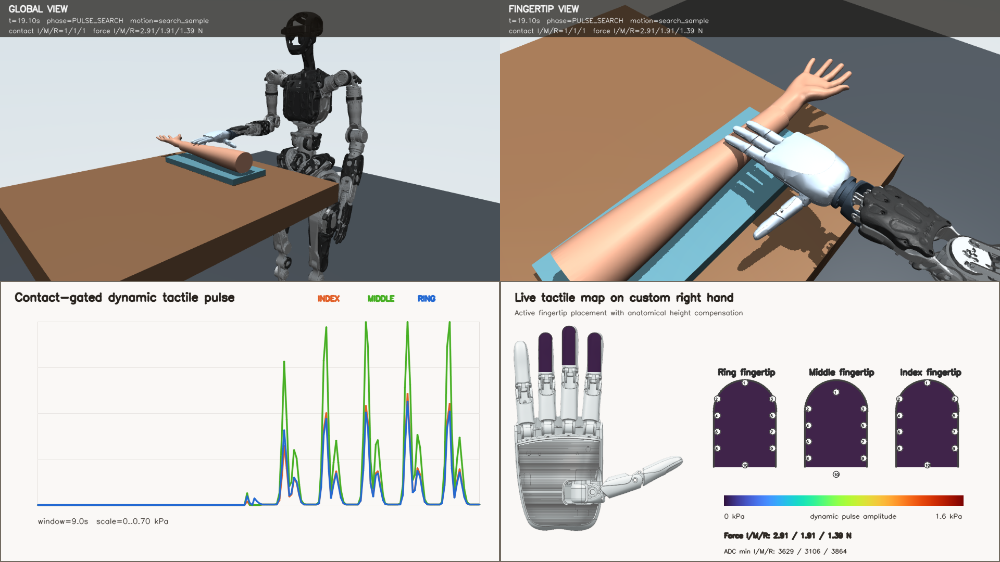
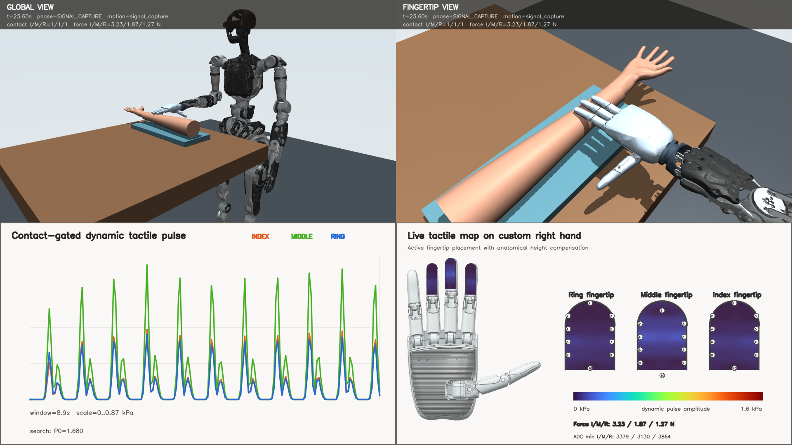

# Adam Pro + HandleL1 MuJoCo Pulse Diagnosis Expert

A self-contained simulation release of the September 2026 contact-first expert. It includes the Adam Pro/HandleL1 scene, patient wrist, 56-channel virtual tactile sensor, synthetic pulse field, deterministic expert, four-panel video recorder, and optional collection/World-VLA training source. No recorded dataset or learned checkpoint is included. This is simulation research code, not a real-robot controller or a clinical diagnostic device.





## What is reproduced

The expert approaches the wrist, establishes contact with the index/middle/ring pads, regulates pressure, searches for a usable pulse, captures a waveform, and retreats. The contact-first configuration is `configs/alignment_pro_custom_right_hand_multifinger_elbow_out_safe_v7_expert_fast_contact_contactfirst.yaml`. Its parent configurations are included. The MuJoCo XML references only files in this repository.

The September 13 source evaluation reported 10/10 accepted randomized episodes, including offsets and sensor/action perturbations; this is a bounded simulation regression, not a real-world success rate. The accepted seed-11 video had 684 frames at 1920x1080/20 FPS, signal quality accepted, no forbidden contacts, and force below the per-finger limit. See `docs/20260913_EXPERT_RANDOM_REGRESSION10_PASS.md` for the exact evaluation contract. The screenshots above are frames from that run. This repository does not ship its 120-episode training dataset or any `.pt` checkpoint.

## System and installation

Target: **Ubuntu 24.04**, x86-64, Python 3.12, NVIDIA GPU with a current Linux driver supporting CUDA 12.8, and working EGL. Ubuntu 26.04 is not required. The tested source environment used MuJoCo 3.2.0, PyTorch 2.10.0 with CUDA 12.8, NumPy 2.4.6, OpenCV-headless 4.13.0.90, PyYAML 6.0.3 and SciPy 1.17.1. GPU model and driver versions may differ; confirm CUDA and EGL with the preflight below. Use an NVIDIA driver compatible with the installed CUDA wheel, rather than installing a full CUDA toolkit just for PyTorch.

```bash
sudo apt update
sudo apt install -y python3.12-venv libegl1 libgl1 libglib2.0-0 ffmpeg
python3.12 -m venv .venv_stage3
.venv_stage3/bin/python -m pip install --upgrade pip
.venv_stage3/bin/python -m pip install torch==2.10.0 --index-url https://download.pytorch.org/whl/cu128
.venv_stage3/bin/python -m pip install -e '.[repro]'
scripts/run_stage3_cuda.sh --check
```

The launcher requires a local `.venv_stage3`, CUDA visibility and a nonblank MuJoCo EGL render. If preflight fails, fix the driver/EGL setup; headless recording and learning runs are not validated with a CPU fallback. A local display is not required.

## Record a complete expert demonstration

Run from the repository root:

```bash
scripts/run_stage3_cuda.sh scripts/run_mujoco_expert_demo.py \
  --config configs/alignment_pro_custom_right_hand_multifinger_elbow_out_safe_v7_expert_fast_contact_contactfirst.yaml \
  --seed 11 --search-strategy signal_quality_early_stop \
  --output-dir outputs/expert_seed11
scripts/run_stage3_cuda.sh scripts/validate_expert_demo_artifacts.py outputs/expert_seed11
```

The output directory contains `expert_demo_1080p_1x.mp4` (front view, fingertip view, tactile curves, palm heatmap), separate `front_view_1x.mp4` and `fingertip_view_1x.mp4`, `result.json`, frame metadata, keyframes, and `tactile_trace.npz`. The trace is generated output, not a bundled dataset. `result.json` records scene/config hashes, success, contact/force/signal checks and video metadata. Optional `--pulse-offset-x-mm` and `--pulse-offset-y-mm` create shifted-pulse tests.

## Collect new data and train models

The collector is resumable and writes a manifest. A one-episode smoke run is:

```bash
scripts/run_stage3_cuda.sh scripts/collect_mujoco_dataset.py \
  --output outputs/collection_smoke --target-accepted 1 --maximum-attempts 3 \
  --seed 20260912 --capture-interval 4 --record-width 320 \
  --record-height 240 --jpeg-quality 85 \
  --config configs/alignment_pro_custom_right_hand_multifinger_elbow_out_safe_v7_expert_fast_contact_contactfirst.yaml \
  --search-strategy signal_quality_early_stop
```

For a longer run use `--target-accepted 120 --maximum-attempts 240`; rerun the same command with `--resume` after an interruption. The source collection used a 96/12/12 episode split. `src/pulse_world_vla/` holds the model framework, `scripts/train_mujoco_world_vla.py` the training entry point, and `scripts/collect_stage3_dagger.py` optional DAgger collection. Their datasets and trained weights must be generated separately. Check `--help` for training input and output arguments; this repository does not promise a pretrained policy. The deterministic expert and video need no `.pt` file.

## Repository layout

| Path | Contents |
| --- | --- |
| `generated/` | Complete Adam Pro + custom right-hand MuJoCo scene |
| `assets/` | Referenced robot/patient meshes, hand artwork and small tactile calibration |
| `configs/` | Contact-first expert and its full inheritance chain |
| `src/pulse_mujoco/` | Backend, expert, safety, pulse field, tactile simulation and recording |
| `src/pulse_world_vla/` | Optional multimodal/action/world-model framework |
| `scripts/` | Preflight, expert recording, validation, collection and training |
| `examples/` | Two accepted four-panel screenshot frames |

The 56 tactile channels follow thumb/index/middle/ring/little = 16/10/10/10/10. The three central fingers are active for diagnosis. The heatmap interpolates measured virtual taxels on the supplied hand drawing; it does not relocate the physical pulse. The pulse center truth is used to construct the synthetic field and for retrospective audit, not as a student observation.

## Notes and attribution

The full robot model needs the referenced PNDbotics Adam Pro meshes. Their BSD 3-Clause license is retained at `third_party/pnd_mujoco/LICENSE`; upstream: https://github.com/pndbotics/pnd_mujoco (source revision `84873eb3c4afd584d468864ba41527a1c14fb688`). The hand, patient approximation and simulation controller are project research assets. Do not connect this expert directly to real hardware: the simulated motor ordering, calibration, force response and safety checks are not a hardware validation.
